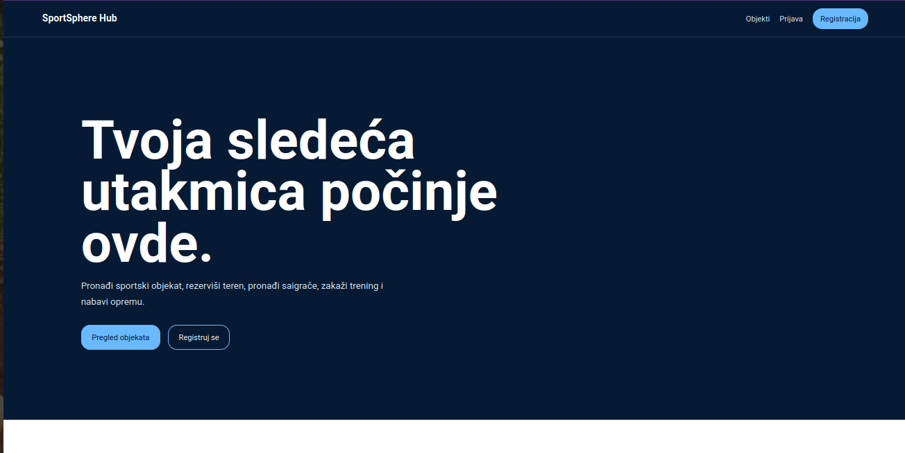
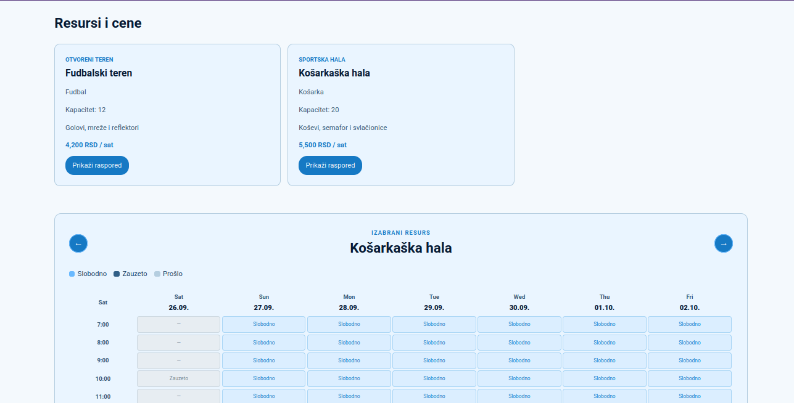
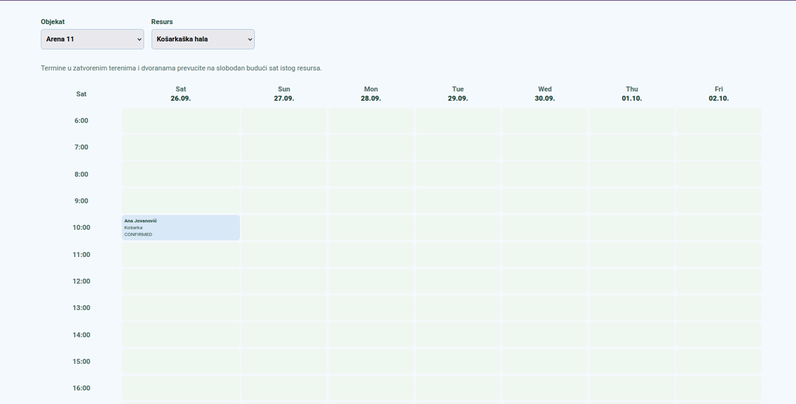
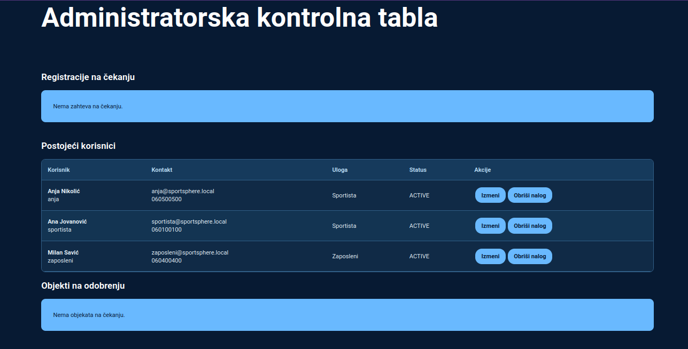

# SportSphere Hub

A sports-facility management system with a Serbian-language interface, built as a
university project for Programiranje za veb (2025/26). Athletes can find
facilities, reserve courts/halls, book individual training, find teammates for
pickup games, and order equipment. Employees manage their organization's
facilities, reservations, promotions, and equipment orders. Administrators
approve registrations and facilities, and manage users, sports, and trainers.

## Features

- **Unregistered visitor:** browse top-rated facilities and current promotions,
  search by name/city/sport/court type, view facility details and pricing.
- **Athlete:** manage profile and reservations, book courts/halls via an
  interactive calendar, find teammates, book individual training, order
  equipment, rate facilities, and view personal activity statistics.
- **Employee:** manage owned facilities and courts/halls, handle reservations
  and training sessions (confirm/no-show), run promotions and equipment stock,
  use a drag-and-drop calendar, and generate monthly PDF reports.
- **Administrator:** approve registrations and new facilities, manage user
  accounts, trainers, and sport types.

## Screenshots

| Home page | Booking calendar |
| --- | --- |
|  |  |

| Employee calendar (drag-and-drop) | Admin panel |
| --- | --- |
|  |  |

## Tech stack

**Frontend:** Angular 20
**Backend:** Spring Boot 3.5, Java 21
**Database:** MySQL 8.4, accessed via JDBC
**Security:** BCrypt password hashing, JWT authentication with server-side role
checks

## Run locally

**Requirements:** Docker with Compose v2, Node.js 22.12+ (22.x) or 24.x, npm, and
Python 3. Java and Maven are supplied by the backend Docker build.

From the repository root:

```bash
python3 scripts/setup-env.py
docker compose up -d --build
cd frontend
npm ci
npm start
```

The setup script creates an ignored `.env` file with unique database passwords
and a random JWT signing key, and refuses to overwrite an existing `.env`.
Alternatively, copy `.env.example` to `.env` and fill in all three secret values
yourself.

| Service | Local address |
| --- | --- |
| Frontend | http://localhost:4200 |
| Backend health | http://localhost:8080/actuator/health |
| Password-reset test inbox | http://localhost:8025 |
| MySQL | `127.0.0.1:3307`, database/user `sportsphere` |

Compose runs MySQL, the backend, and Mailpit. The Angular frontend is run
separately. Published container ports bind to loopback only. Mailpit captures
local messages and does not deliver them to external recipients.

### Demo accounts

On a **fresh database**, all accounts below use the password **`DemoPass1!`**:

| Username | Role | Login page |
| --- | --- | --- |
| `admin` | Administrator | `/administracija/prijava` |
| `sportista` | Athlete | `/prijava` |
| `anja` | Athlete | `/prijava` |
| `zaposleni` | Employee | `/prijava` |

New registrations require administrator approval before login is possible.
Passwords must be 8–12 characters, start with a letter, and include an
uppercase letter, a digit, and a special character.

To test the forgotten-password flow: submit a demo username, open the Mailpit
inbox, and follow the emailed link. Links expire after 30 minutes and can be
used once. The API never returns the reset link directly, and unknown accounts
receive the same response as known accounts (to avoid leaking which usernames
exist).

## Repository contents

```text
backend/          Java source, tests, Maven configuration and Dockerfile
frontend/         Angular source, tests, public assets and npm lockfile
database/         Initial schema and clearly labeled local demo data
examples/         JSON facility-import examples for the employee import screen
scripts/          Local environment setup and isolated integration check
docs/             Screenshots
.github/          Continuous-integration workflow
compose.yml       Local MySQL/backend/test-inbox stack
.env.example      Configuration template without credentials
```

## Notes

This project was built to satisfy the requirements of a university course
assignment; the database is seeded independently of the application and is not
created by the app itself. Tested in Chrome, Firefox, and Edge.
